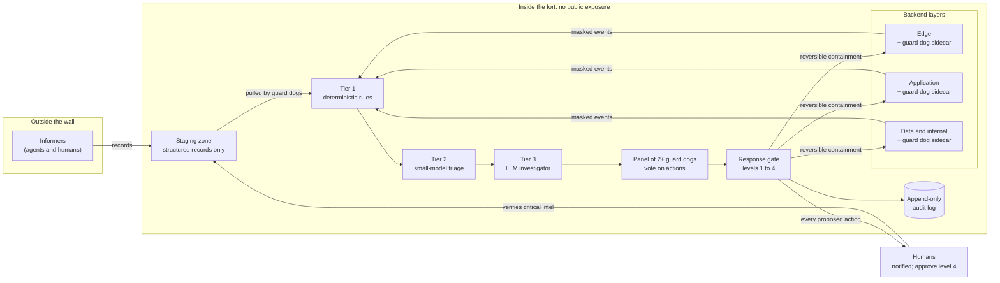

# Guard Dogs

An active patrol layer for web runtimes (Node, PHP) in the AI-attacker era.

> **Status: early research prototype (v0.0.1).** This is a scaffold: shared schemas and three small, tested building blocks. It is not a product, it does not protect anything yet, and the interfaces will change.

## The idea

Patching is the real fix, and nothing here replaces it. But patches take time to ship and deploy, and AI-assisted attackers can turn a disclosure into exploit attempts quickly. Most defences are passive: they wait for a request to match a signature.

A **guard dog** is different. It is a small agent that runs as a **sidecar on every backend layer**, patrols continuously, and looks for discrepancies:

- **Exposure patrol**: what is installed, and does any trusted advisory say it is vulnerable?
- **Drift patrol**: do web roots, processes, outbound calls, LLM API calls and MCP tooling still match the baseline?
- **Probe patrol**: can the system be fooled the way an attacker would try? (Planned, simulated and inert traffic only.)

Where a layer is already protected (a WAF, an API gateway), the guard dog watches that control's logs and **acts only on a discrepancy**, through the control's own rule interface and only in a time-boxed, reversible way. Where a layer has no control, it acts as the control.

## Design principles

| Principle | What it means here |
| --- | --- |
| Tiered detection | Tier 1 deterministic rules, tier 2 small-model triage, tier 3 LLM investigator. Higher tiers see less volume and cost more. |
| Investigators propose, never execute | A response gate executes. A panel of **at least two** guard dogs must agree before any containment. A split goes to a human. |
| Graduated response | 1 observe, 2 alert, 3 contain (reversible, expiring), 4 contain (disruptive, human approval). Every proposed action notifies a human. |
| The fort | Guard dogs are never publicly exposed. They pull from a staging zone; nothing is pushed in. Egress is allow-listed. |
| Informers | Agents and humans outside the wall emit **structured records only**. Critical intel needs human verification before guard dogs act on it. |
| Mask first | Logs are masked before any model call. Hosted model APIs to start; self-host if data sovereignty matters. |
| Guard dogs are targets | Prompt injection through logs, forged advisories, over-privilege and audit tampering are in the threat model from day one. |

See [docs/design.md](docs/design.md) for the rules the code already enforces.

## Architecture



## What is in this repository

| Path | What it is | Status |
| --- | --- | --- |
| `schemas/` | Language-neutral JSON Schemas: events, informer records, proposed actions, audit entries. A PHP sidecar can use the same files. | Draft v0 |
| `src/exposure/matcher.ts` | **Advisory matcher.** Matches informer records against the inventory. Validates records at the trust boundary, enforces the source allow-list, and caps the response level for unverified intel. | Tested |
| `src/rules/` | **Tier 1 rules engine.** Three drift rules (executable in a web root, unexpected outbound host, web process spawning a shell) with sanitised evidence. | Tested |
| `src/audit/log.ts` | **Audit log.** Append-only, hash-chained JSONL with tamper detection and external anchoring. | Tested |
| `src/masking/` | **Log masking.** Removes secrets, tokens, emails and card numbers, and replaces client IPs with keyed pseudonyms, before an event reaches tier 1 or any model. Only `maskEvent` produces `masked: true`. | Tested |
| `src/gate/` | **Response gate.** Decides what happens to a proposed action: run, wait for a human, or deny. Enforces the response levels, panel voting with distinct members and models, pre-approved scopes, protected targets, intel ceilings, and human approvals tied to the exact action. It executes nothing itself. | Tested |
| `src/executor/` | **Executor.** The only way a proposal becomes a change. Audits before acting and fails closed, expires and reverts containment, limits how much automatic containment can run, refuses a repeated action id, and recovers its state from the audit log after a restart. Real controls plug in as adapters. | Tested |
| `fixtures/` | Synthetic records, events and actions. Nothing here is a real advisory or a working exploit. | |

Not built yet: sidecars, tier 2 and tier 3, the investigator agents that make up the panel, the probe patrol, and the evaluation testbed.

## Quick start

Requires Node 22 or newer.

```sh
npm install
npm run check   # typecheck and run the tests
npm run build
```

Example: match an advisory against what you run.

```ts
import { matchAdvisories } from 'guard-dogs';

const { findings, rejected } = matchAdvisories(
  [{ ecosystem: 'npm', name: 'example-lib', version: '1.2.0', service: 'shop-web', layer: 'application' }],
  recordsFromStagingZone, // unknown[]: validated, never trusted
  { allowedSources: new Set(['example-advisory-feed']) },
);
// An unverified critical record yields maxLevel 2 (alert) and needsHumanVerification: true.
```

## Limits to be honest about

- Masking is pattern-based. It favours over-masking, but it cannot recognise every secret format, names, phone numbers or free-text personal data. Treat it as one layer: keep secrets out of logs at the source too.
- Tier 1 rules are starting points, not a complete baseline. Real services will need per-service baselines and allow-lists, and they will produce false positives until tuned.
- The audit log detects tampering in the middle of the chain. Detecting a removed tail or a rewritten chain needs an anchor stored where the writer cannot reach.
- Sanitising evidence is hygiene, not a defence against prompt injection. Anything sent to a model must still be delimited and treated as data.
- Ranges are matched with semver rules. Composer versions that are not semver-like are coerced and may match imprecisely.

## Safety and scope

This project is defensive. Contributions must not include working exploits. Testing uses simulated, inert traffic in an isolated environment. See [CONTRIBUTING.md](CONTRIBUTING.md) and [SECURITY.md](SECURITY.md).

## License

Apache-2.0. See [LICENSE](LICENSE).

## Citing

See [CITATION.cff](CITATION.cff).
